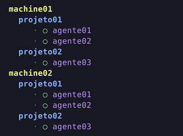

# Agents Sidebar

A [Herdr](https://herdr.dev) plugin that groups native sidebar agents
by machine and workspace, using indentation for projects and agents.

Machine and project headings stay attached to real agents, preserving native
status and navigation. **Settings** lets you choose the three group colors,
including **Default** (yellow machines, blue projects and purple names), and turn the `·`
separator between machines on or off.

Requires Linux, Herdr 0.9.3+ and Python 3.11+ with curses.
Runtime uses Python's standard library.



Install from GitHub:

```sh
herdr plugin install C0R0NELL/herdr-agents-sidebar
```

Choose **Apply sidebar** in the Plugin Manager to activate it in the current
session. **Settings** changes colors and the machine separator live.

See [development](docs/development.md) for installation and durable settings,
[verified behavior and limits](docs/viabilidade.md), and
[publishing](docs/publishing.md) for the release workflow.
