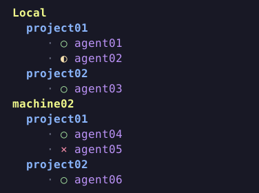
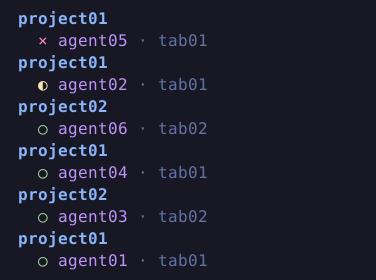

# Agents Sidebar

A [Herdr](https://herdr.dev) plugin with grouped and priority layouts
for the native agent sidebar.

Machine and project headings stay attached to real agents, preserving native
status and navigation. **Settings** provides independent layouts and colors,
including **Default** (yellow machines, blue projects, purple names and dark blue tabs), and turns the `·`
separator between machines on or off. The separator starts **Off**.

Requires Linux, Herdr 0.9.3+ and Python 3.11+ with curses.
Runtime uses Python's standard library.

| Grouped | Priority |
| --- | --- |
|  |  |

Install from GitHub:

```sh
herdr plugin install C0R0NELL/herdr-agents-sidebar
```

After installation, open this plugin's **Settings** in the Plugin Manager.
Choose the **Grouped** or **Priority** tab to match the order currently selected
in Herdr's agent sidebar, then set **Active → Yes**. Both modes start inactive;
activating one leaves the other inactive. Settings does not change Herdr's order.
Set both to **No** to restore Herdr's default native layout, including machine
labels, keeping both profiles saved.
Grouped keeps the machine/project tree; **View → Edit line** arranges or hides
Status, Agent, Tab, Pane, Status text and raw/clean Terminal title on one agent line.
Priority's **View → Edit lines** offers the same fields plus Machine and Project
across two lines. New details start hidden with Dark blue colors; each mode saves
its own view and colors.
The Grouped tree requires Grouped order in Herdr. Priority rows work with either
native order. Settings changes apply live;
Show separator affects Grouped.
**Restart sidebar** reloads the worker while keeping settings and activation.
**Restore defaults** resets both profiles to the factory layout with both inactive.

See [development](docs/development.md) for installation and durable settings,
[verified behavior and limits](docs/viabilidade.md), and
[publishing](docs/publishing.md) for the release workflow.
